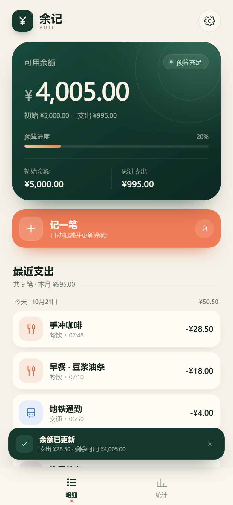
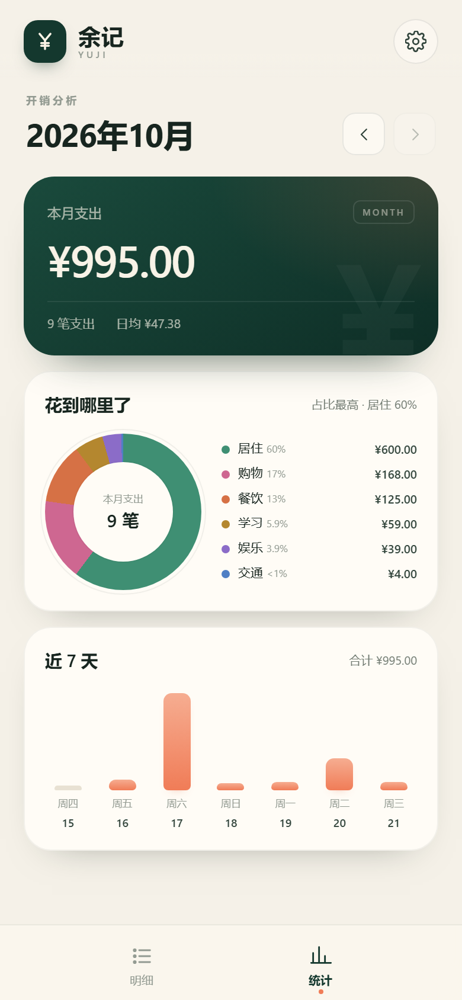

# 余记 · 手机记账

一个不需要注册、打开就能用的手机记账应用。先设置初始可用金额，之后每记一笔开销，余额会自动扣除，并明确显示剩余可用资金。

<p align="center">
  
  
</p>

> 第一次使用请先看：[使用教程](使用教程.md)

## 功能

- **首次设置初始金额**：支持手工输入或快捷选择 ¥1,000 / ¥3,000 / ¥5,000 / ¥10,000。
- **自动扣减余额**：输入金额时就实时预览“记完后剩余可用”；保存后余额卡片更新，并弹出“支出 ¥xx · 剩余可用 ¥xx”的结果提示。
- **支出明细**：按今天 / 昨天 / 日期分组，支持分类、备注和补记时间。
- **分类统计**：月度支出、分类占比、近 7 天趋势。
- **修改初始金额**：余额会按新金额重新计算，已有记录保留。
- **删除与清空**：单笔删除需要二次确认；清空记录时保留初始金额。
- **CSV 导出**：导出时间、分类、备注、金额和每笔记账后的余额。
- **本机保存**：数据存放在浏览器 `localStorage`，不会上传。
- **可安装 PWA**：通过 HTTP(S) 访问时支持添加到手机主屏幕和离线打开。

## 打开方式

### 直接打开

双击 `index.html` 即可使用，基本记账和本地保存都可用。部分手机浏览器对 `file://` 页面的本地存储限制较严，更推荐下面的本地服务方式。

### 本地预览服务（推荐）

双击 `start-phone.cmd`（启动手机访问），会同时启动本机预览和手机可访问的局域网服务，并打印类似：

```text
电脑本机：http://localhost:4780
手机访问：http://192.168.1.20:4780
```

手机连接同一个 Wi-Fi 后，打开窗口里的“手机访问”地址即可。

也可以手动启动：

```powershell
node server.mjs --port 4780
```

如果手机打不开，双击 `allow-phone.cmd`（允许手机访问）放行 Windows 防火墙的 TCP 4780 端口，并按 [使用教程](使用教程.md#手机打不开怎么办) 逐项排查。

> 手机通过局域网 HTTP 访问时可以正常记账，但 Service Worker / 离线安装通常要求 HTTPS；需要安装为 PWA 时，把整个目录部署到任意 HTTPS 静态站点即可。

### 添加到主屏幕

- iPhone Safari：分享 → 添加到主屏幕。
- Android Chrome / Edge：菜单 → 安装应用 / 添加到主屏幕。

## 数据说明

- 存储键：`yuji-ledger-v1`。
- 清除浏览器数据、使用无痕模式、更换浏览器或设备都会导致记录不可见。
- 建议在设置面板中定期“导出账单”备份。
- 金额在内部以“分”为单位保存，避免浮点误差。

## 文件结构

```text
mobile-ledger/
├── index.html              页面结构
├── styles.css              手机优先样式
├── app.js                  记账、统计、存储与交互
├── server.mjs              本地 / 局域网静态服务器
├── start-phone.cmd         一键启动电脑与手机访问
├── start-phone.ps1         一键启动脚本
├── allow-phone.cmd         可选：放行 Windows 防火墙端口
├── manifest.webmanifest    PWA 配置
├── sw.js                   Service Worker（离线缓存）
├── icon.svg                矢量图标
├── icons/                  主屏幕图标
├── preview/                界面预览截图
├── 使用教程.md             完整图文教程
└── tools/make_icons.py     图标生成脚本（开发用）
```

## 设计要点

- 余额计算：`剩余可用 = 初始金额 − 所有支出合计`
- 初始金额和每笔支出都以整数分保存；显示时统一格式化。
- 不依赖框架、构建工具或外部字体，静态文件直接运行。
