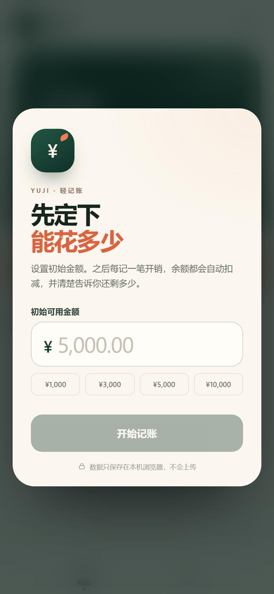
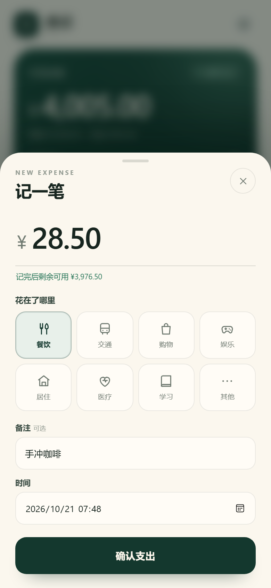
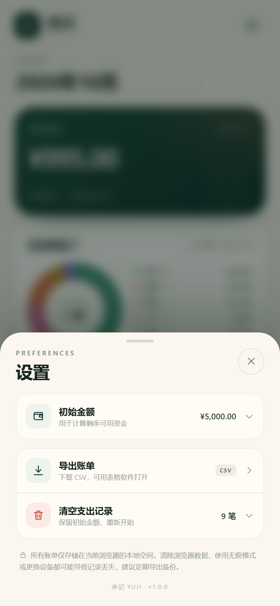

# 余记 · 使用教程

## 1. 打开应用

手机或电脑可以直接打开在线版：

<https://dr-jhr.github.io/yuji-ledger/>

电脑本地也可以打开：

<http://127.0.0.1:4780>

如果预览服务没有启动，双击 `start-phone.cmd`（启动手机访问），然后打开 <http://localhost:4780>。

也可以直接打开项目里的 `index.html`。

> 手机上访问时，需要让手机和电脑处于同一 Wi-Fi，并使用窗口里显示的“手机访问”地址（见第 10 节）。



## 2. 第一次使用：设置初始金额

第一次打开会看到欢迎页：

1. 在“初始可用金额”输入框填入准备用于这段时间的金额，例如 `5000`。
2. 也可以点下方的快捷金额：`¥1,000`、`¥3,000`、`¥5,000`、`¥10,000`。
3. 点“开始记账”。

设置完成后，首页余额会显示这笔初始金额：

```text
可用余额 = 初始金额 − 所有支出
```

> 初始金额可以理解为“这段时间最多准备花多少”，之后可以在设置里修改。

## 3. 记一笔支出

点首页显眼的橙色“记一笔”按钮。



按顺序填写：

1. **金额**：输入本次花了多少，例如 `28.50`。
2. **分类**：选择餐饮、交通、购物、娱乐、居住、医疗、学习或其他。
3. **备注**：可选，例如“楼下的牛肉面”。
4. **时间**：默认是当前时间，补记旧账时可以修改。

输入金额后，金额下方会实时显示：

```text
记完后剩余可用 ¥3,976.50
```

如果这笔支出会超过余额，则会变成红色提示：

```text
这笔会超出可用余额 ¥xx.xx
```

确认无误后点“确认支出”。

## 4. 查看自动扣减结果

保存后会自动回到首页，并完成三件事：

1. 顶部“可用余额”立即减去本次支出。
2. 页面底部弹出结果提示：
   `支出 ¥28.50 · 剩余可用 ¥4,005.00`
3. 新支出出现在“最近支出”列表顶部。


例如初始金额是 `¥5,000.00`，已经支出 `¥966.50`，再记一笔 `¥28.50`：

```text
5,000.00 − 966.50 − 28.50 = 4,005.00
```

余额卡片下方也会显示“初始 ¥5,000.00 − 支出 ¥995.00”，方便核对。

## 5. 查看、删除和修改支出

### 查看详情

在“最近支出”里点任意一笔，会打开详情，显示：

- 分类和金额
- 支出时间
- 备注
- 删除这笔后会恢复的余额

### 删除

点“删除这笔支出”后，需要再点一次“确认删除”，防止误删。

### 修改

当前版本暂不支持直接编辑已有记录。如果记错了金额、分类或时间，可以先删除这笔，再重新记一笔。

## 6. 查看统计

点底部“统计”：


- 顶部显示当月总支出、笔数和日均支出。
- 圆环图显示各分类占比。
- 右侧图例显示每个分类的金额和百分比。
- 下方柱状图显示近 7 天每天的支出。
- 点右上角 `‹` `›` 可以切换月份，查看历史月份。

## 7. 修改初始金额

1. 点首页右上角的齿轮按钮。
2. 点“初始金额”这一行。
3. 输入新的初始金额，点“保存”。



修改后，已有支出记录不会丢失，余额会按新金额重新计算。如果新金额低于已支出合计，页面会正常显示“已超支”和负数余额，方便你了解超支情况。

## 8. 导出账单备份

进入“设置” → “导出账单”，会下载一个 CSV 文件，例如：

```text
余记账单_2026-10-21.csv
```

包含列：

| 时间 | 分类 | 备注 | 金额（元） | 记账后余额（元） |
| --- | --- | --- | --- | --- |
| 2026-10-21 07:10 | 餐饮 | 早餐 | 18.00 | 4982.00 |

可以用 Excel、WPS、Numbers 等表格软件打开。建议每月导出一次备份。

## 9. 清空支出记录

“设置” → “清空支出记录” → “确认清空”。

- 会删除全部支出记录。
- 初始金额会保留。
- 此操作不能撤销，重要数据请先导出 CSV。

## 10. 在手机上使用

### 最方便：直接使用在线版

手机浏览器打开：

```text
https://dr-jhr.github.io/yuji-ledger/
```

这是 HTTPS 地址，可以直接添加到主屏幕，并支持离线打开。下面的局域网方式是本地开发和没有网络时的备选方案。

### 方法一：一键启动（推荐）

1. 双击 `start-phone.cmd`（启动手机访问）。
2. 窗口会显示类似：

   ```text
   电脑本机：http://localhost:4780
   手机访问：http://192.168.1.20:4780
   ```

3. 让手机连接与电脑同一个 Wi-Fi。
4. 在手机浏览器打开窗口中显示的“手机访问”地址。
5. 使用期间保持这个窗口运行；关闭窗口或按 `Ctrl+C` 后服务停止。

> 这个地址是电脑当前的局域网 IP，可能会随路由器重新分配而变化，以每次窗口显示的地址为准。

### 手机打不开怎么办

按顺序检查：

1. **地址是否正确**：手机不能打开 `http://127.0.0.1:4780` 或 `http://localhost:4780`，这两个地址只代表电脑自己。手机必须用 `http://电脑局域网IP:4780`。
2. **是否同一网络**：手机和电脑连接同一个 Wi-Fi；不要使用访客 Wi-Fi，部分路由器的访客网络会隔离设备。
3. **防火墙**：双击 `allow-phone.cmd`（允许手机访问），同意管理员权限，开放 TCP 4780。建议只在家庭等可信 Wi-Fi 下使用。
4. **网络类型**：如果 Windows 把当前 Wi-Fi 标为“公用网络”，仍可使用上面的防火墙脚本放行；也可以在 Windows 设置中把家庭 Wi-Fi 改为“专用网络”。
5. **端口占用**：如果 4780 被其他程序占用，关闭旧服务，或运行：

   ```powershell
   node server.mjs --port 4781
   ```

   手机地址也相应改成 `http://电脑IP:4781`。

如果只是想在电脑上使用，运行 `start-phone.cmd` 后打开 `http://localhost:4780` 即可，不影响手机访问。

### 方法二：手动启动

在 `mobile-ledger` 目录运行：

```powershell
node server.mjs --port 4780
```

或使用 Python：

```powershell
python -m http.server 4780 --bind 0.0.0.0
```

然后运行 `ipconfig` 找到 Wi-Fi 的 IPv4 地址，在手机浏览器打开 `http://该地址:4780`。

> 通过局域网 HTTP 访问可以正常记账，但“添加到主屏幕”和离线能力通常需要 HTTPS。把整个目录部署到任意 HTTPS 静态站点即可获得完整 PWA 能力。

### 添加到主屏幕

- **iPhone Safari**：分享按钮 → “添加到主屏幕”。
- **Android Chrome / Edge**：浏览器菜单 → “安装应用”或“添加到主屏幕”。

安装后可以像普通 App 一样从桌面打开。

## 11. 数据保存在哪里

- 所有数据只保存在当前浏览器的本地存储里，不会上传服务器。
- 换手机、换浏览器、清除浏览器数据、使用无痕模式，都可能导致记录不可见。
- 想长期保存，请定期使用“导出账单”。
- 同一个手机、同一个浏览器再次打开，记录会自动恢复。

## 12. 常见问题

**Q：为什么余额变成了负数？**
A：累计支出已经超过初始金额。可以修改初始金额，或删除/更正多记的支出。

**Q：为什么金额输不进去？**
A：金额必须大于 0，最多两位小数；字母和多余的小数位会被自动过滤。

**Q：记错了时间怎么办？**
A：删除这笔后重新记一笔，在“时间”里选择正确时间。当前版本暂不支持直接编辑单笔记录。

**Q：换了手机记录还在吗？**
A：不在。数据不跨设备同步。请在旧设备导出 CSV，作为备份。

**Q：能记录收入或退款吗？**
A：当前版本专注“支出扣减”。如果需要收入/退款、预算周期、多账户等功能，可以继续扩展。

---

如果只是日常使用，记住这个流程就够了：

**设置初始金额 → 点“记一笔” → 输入金额和分类 → 确认支出 → 看剩余可用资金。**
